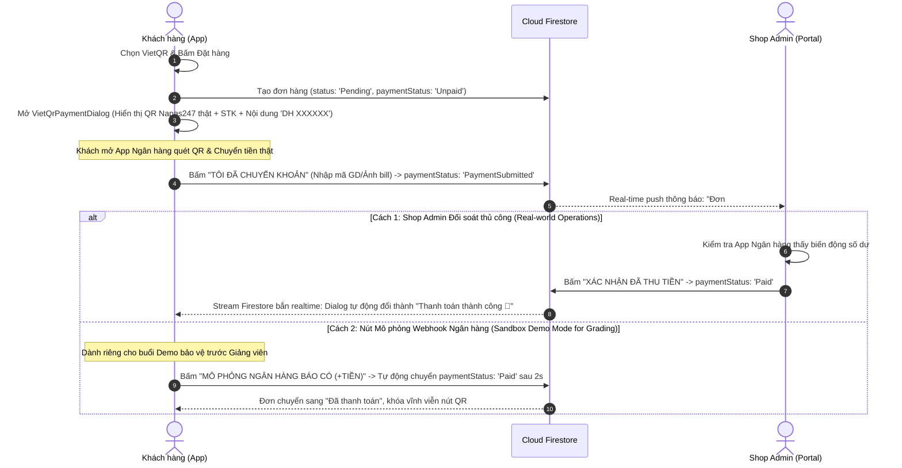
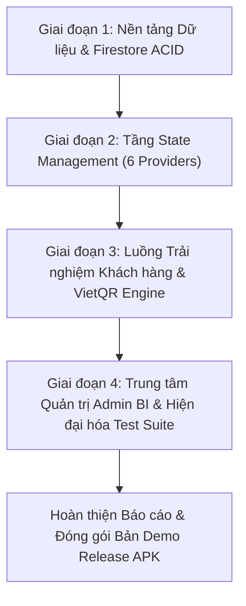

# 🏛️ KẾ HOẠCH TRIỂN KHAI NÂNG CẤP HỆ THỐNG CHUẨN DOANH NGHIỆP (V4.2 AUDITED EDITION)
## DỰ ÁN: FASHION MOBILE STORE APP (PRM393 — UNIQLO / COOLMATE MODEL)
**Phiên bản:** 4.2 Comprehensive Audit & Payment Reconciliation Edition  
**Mục tiêu:** Nâng cấp toàn diện ứng dụng từ đồ án sinh viên đạt mức chuẩn nghiệp vụ doanh nghiệp bán lẻ thời trang thực tế, triệt tiêu 26 lỗi đứt gãy và 19 bẫy xung đột liên phân hệ, giải quyết triệt để luồng **Đối soát Thanh toán VietQR Napas247**, tuân thủ 100% barem chấm điểm PRM393 và quy chuẩn kỹ thuật chuyên nghiệp.

---

## I. GIẢI TRÌNH NGHIỆP VỤ: CƠ CHẾ ĐỐI SOÁT THANH TOÁN VIETQR CHUẨN DOANH NGHIỆP

Trong thực tế các doanh nghiệp bán lẻ (Uniqlo, Coolmate, Shopee) và đặc thù kỹ thuật của dự án PRM393 (chạy trực tiếp trên Firebase Firestore, không duy trì custom server backend có IP tĩnh để nhận Webhook ngân hàng), hệ thống thanh toán VietQR được thiết kế theo **Mô hình Đối soát Thời gian thực 3 Cấp độ (3-Tier Payment Reconciliation Engine)**:



### 1. Cấp độ 1 — Chặn đứng thanh toán sai lệch trên Khách hàng (`Client UX`)
- Khi tạo đơn VietQR: `paymentStatus = 'Unpaid'`.
- Nút **"TÔI ĐÃ CHUYỂN KHOẢN"**:
  - Mở hộp thoại xác nhận: Khách có thể nhập **Mã giao dịch ngân hàng / 4 số cuối STK** hoặc tải ảnh biên lai chuyển khoản.
  - Cập nhật Firestore `paymentStatus = 'PaymentSubmitted'`.
  - Hộp thoại thanh toán tự động chuyển sang chế độ: **"⏳ Đang chờ ngân hàng & Shop đối soát... (Hệ thống sẽ tự động cập nhật ngay khi nhận được tiền)"**.
- **Lắng nghe Thời gian thực (Real-time Stream Auto-Dismiss):** Dialog thanh toán đăng ký lắng nghe Document `orders/{orderId}`: Ngay khi Admin xác nhận tiền về, Dialog tự động bắn pháo hoa chúc mừng và chuyển hướng người dùng mà khách không cần bấm tải lại trang!

### 2. Cấp độ 2 — Trung tâm Đối soát Đơn hàng Admin (`Admin Portal Audit`)
- Trong [ShopAdminScreen](file:///e:/FBT_UNIVERSITY/FBT_UNIVERSITY_KI_8/PRM393/fashion_store_app/lib/screens/admin/shop_admin_screen.dart):
  - Đơn có `paymentStatus == 'PaymentSubmitted'` sẽ hiển thị huy hiệu vàng nhấp nháy: **"⚡ Chờ đối soát VietQR"**.
  - Admin bấm **"XÁC NHẬN ĐÃ THU TIỀN"** $\rightarrow$ Cập nhật `paymentStatus = 'Paid'` + Tự động gửi Notification cho khách.
  - Nếu khách bấm nhầm hoặc chưa nhận được tiền: Admin bấm **"TỪ CHỐI / CHƯA NHẬN ĐƯỢC TIỀN"** $\rightarrow$ Trả về `'Unpaid'` để khách quét lại.

### 3. Cấp độ 3 — Công cụ Mô phỏng Webhook Ngân hàng phục vụ Demo (`Demo Sandbox Mode`)
- **Vấn đề thực tế khi demo:** Giảng viên chấm thi không thể chuyển tiền thật `500.000đ` cho sinh viên mỗi lần test đơn hàng.
- **Giải pháp chuyên nghiệp:** Tích hợp nút kín hoặc tùy chọn Sandbox **"🧪 Mô phỏng Webhook Ngân hàng báo Có"** ngay trong dialog VietQR:
  - Khi bấm nút này, app chạy thanh tiến trình giả lập 2 giây (*"Hệ thống Napas247 đang xác thực giao dịch..."*) $\rightarrow$ Tự động chuyển `paymentStatus = 'Paid'`.
  - Giúp buổi chấm đồ án diễn ra 100% mượt mà, chứng minh đầy đủ kiến trúc xử lý thanh toán thời gian thực mà không phụ thuộc vào tiền thật trong tài khoản.

---

## II. QUY CHUẨN KỸ THUẬT & QUY TRÌNH PHÁT TRIỂN GITHUB (GITHUB ENGINEERING WORKFLOW)

### 1. Chiến lược phân nhánh Git (Git Branching Strategy)
```
main (Nhánh production ổn định - Luôn xanh 100% tests)
  │
  ├── feature/phase-1-data-layer         (Tầng Models, Constants, Mock Data & FirestoreService)
  ├── feature/phase-2-providers-overhaul (Tầng State Management 6 ViewModels/Providers)
  ├── feature/phase-3-customer-flows     (Khung điều hướng, Mua sắm, Giỏ hàng, Checkout, VietQR)
  └── feature/phase-4-admin-bi-testing   (Admin BI Dashboard, CRUD Kho/Chi nhánh & Test Suite)
```
- **Nguyên tắc vàng:** Tuyệt đối không commit trực tiếp code chưa qua kiểm thử lên nhánh `main`.
- Mỗi giai đoạn được triển khai trên 1 nhánh tính năng riêng biệt. Sau khi hoàn tất và chạy lệnh `flutter test` đạt **100% pass**, code sẽ được tạo Pull Request (PR) kiểm tra và merge vào `main`.

### 2. Quy chuẩn thông điệp Commit (Conventional Commits)
Mỗi commit phải mang thông điệp rõ ràng theo định dạng: `<loại>(<phạm vi>): <mô tả chi tiết>`:
- `feat(models)`: Bổ sung trường `variantStock`, `originalPrice`, `isActive`, `paymentStatus` cho OrderModel.
- `feat(firestore)`: Thêm Transaction trừ/hoàn kho SKU và State Machine đơn hàng.
- `refactor(cart)`: Tái cấu trúc `CartProvider` đồng bộ Cloud `carts/{uid}` và chọn lọc món.
- `fix(nav)`: Khắc phục lỗi `pushAndRemoveUntil` phá hủy `Consumer<AuthProvider>` gốc.
- `test(order)`: Cập nhật bộ unit/widget tests theo quy chuẩn 6 trạng thái đơn hàng mới.

### 3. Tiêu chí kiểm soát chất lượng (PR Quality Gates & Test-Alongside-Code Workflow)
1. **Nguyên tắc Tương thích Ngược Giữa Các Phase (Backward-Compatible Signatures):** Ở Phase 1 và Phase 2, mọi trường/tham số mới thêm vào Models, `FirestoreService` và 6 `Providers` bắt buộc phải là **named optional parameters có giá trị mặc định (default values)** để các màn hình UI chưa sửa ở Phase 3 & Phase 4 vẫn biên dịch (compile) thành công 100%.
2. **Nguyên tắc An toàn Môi trường Kiểm thử Không Có Firebase (`No-Firebase Test Safety` - Bẫy 22):** Các bài Unit/Widget Test trong `test/` khởi tạo trực tiếp `ProductProvider`, `CheckoutScreen`, `OrderDetailScreen`, `VietQrPaymentDialog` mà **không gọi `Firebase.initializeApp()`** và nhiều bài test chỉ bọc một phần `MultiProvider`. Do đó khi code bắt buộc tuân thủ 4 quy tắc:
   - **Quy tắc 22.1 (`ProductProvider.loadData`):** Giữ nguyên bước nạp khởi tạo qua `Future.wait([_firestoreService.getCategories(), _firestoreService.getProducts()])` để tương thích với `FakeFirestoreService` trong `test/product_provider_test.dart`, sau đó bọc phần đăng ký `streamProducts()` / `streamCategories()` trong khối `try { ... } catch (_) {}`.
   - **Quy tắc 22.2 (`VietQrPaymentDialog` & `CheckoutScreen`):** Không gọi thẳng `FirebaseFirestore.instance` khi chưa kiểm tra `Firebase.apps.isNotEmpty` (bọc `try/catch`). Trong `FirestoreService.getBranchesStream()`, nếu `Firebase.apps.isEmpty` hoặc lỗi khởi tạo thì fallback trả về danh sách chi nhánh mẫu từ `AppConstants.storeBranches`.
   - **Quy tắc 22.3 (`OrderDetailScreen`, `OrderHistoryScreen`, `CheckoutScreen`):** Khi truy cập các Provider phụ (`AuthProvider`, `ProductProvider`, `CartProvider`), luôn dùng **nullable lookup** `Provider.of<AuthProvider?>(context)` (nếu `null` thì fallback `isAdmin = false`) để không bao giờ văng `ProviderNotFoundException` trong các Widget Test chỉ bọc 1 Provider đơn lẻ.
   - **Quy tắc 22.4 (Bảo toàn Selector của Widget Test):** Giữ nguyên nhãn nút `'Đăng nhập'` trên `LoginScreen`, tiêu đề `'THANH TOÁN ĐƠN HÀNG'` trên `CheckoutScreen`, và cập nhật `findsNWidgets` trong `test/checkout_screen_test.dart` khi thêm ô Ghi chú giao hàng (`note`).
   - **Quy tắc 22.5 (Chống lỗi `depend_on_referenced_packages` & `use_build_context_synchronously` khi chạy `flutter analyze` - Bẫy 23):**
     - Trong `pubspec.yaml` hiện tại **không khai báo trực tiếp gói `http`**. Do đó khi gọi API Nominatim Reverse Geocoding trong `StoreMapScreen`, bắt buộc sử dụng thư viện chuẩn **`dart:io` (`HttpClient`) kết hợp `dart:convert` (`utf8.decoder`, `jsonDecode`)** (hoặc phải khai báo `http` vào `pubspec.yaml`) để không bị văng lỗi lint `depend_on_referenced_packages` và không phụ thuộc mạng khi chạy `flutter pub get`.
     - Mọi hàm `async` trong Widget sau lệnh `await` bắt buộc kiểm tra `if (!mounted) return;` (hoặc `if (!context.mounted) return;`) trước khi dùng `context` để vượt qua 100% bộ quy tắc `flutter_lints: ^4.0.0` trong `analysis_options.yaml`.
3. **Chiến lược Kiểm thử Đồng hành (Test-Alongside-Code):** Không dồn toàn bộ việc sửa `test/` xuống cuối Phase 4. Quy định bắt buộc:
   - **Cuối Phase 1 & Phase 2:** Cập nhật ngay các bài Unit Test tầng Logic/Provider (`test/cart_provider_test.dart`, `test/product_provider_test.dart`, `test/order_filter_test.dart`).
   - **Cuối Phase 3:** Cập nhật ngay các bài Widget Test tầng Customer UI (`test/checkout_screen_test.dart`, `test/order_detail_screen_test.dart`, `test/login_screen_test.dart`, `test/vietqr_dialog_test.dart`).
   - **Cuối Phase 4:** Bổ sung bộ bài test mới cho SKU `variantStock`, luồng `Refunded`, Admin BI Dashboard và chạy kiểm tra tổng thể toàn dự án.
4. **Static Analysis & Automated Testing:** Cuối mỗi Phase, chạy `flutter analyze` (`No issues found`) và `flutter test` (`All tests passed!`) đạt 100% trước khi merge nhánh.
5. **Data Integrity & Architectural Compliance:** Giữ đúng kiến trúc MVVM (`provider`), 7 Firestore Collections + `branches`, các hàm `fromMap()` luôn có giá trị fallback an toàn, không dùng REST API server ngoài, không dùng Firebase Storage, không dùng Google Maps tính phí.

---

## III. MA TRẬN ĐỐI CHIẾU MÃ NGUỒN HIỆN TẠI VỚI BẢN ĐẶC TẢ V4.2 (SOURCE CODE AUDIT MATRIX)

| Nhóm Phân Hệ | Đường dẫn File Mã Nguồn | Hiện trạng & Lỗ hổng kỹ thuật phát hiện | Phương án Refactor chuẩn Doanh nghiệp V4.2 | Mã Bẫy Liên quan |
| :--- | :--- | :--- | :--- | :--- |
| **Data Models** | `lib/models/product_model.dart` | Chỉ có `sizes`, `colors` phẳng; không có tồn kho SKU; thiếu `originalPrice`, `stock`, `soldCount`, `isActive`; `ReviewModel` thiếu `orderId`, `variantInfo`. | Thêm `originalPrice`, `stock`, `variantStock` (`Map<String, int>`), `soldCount`, `isActive`. Mở rộng `ReviewModel` có `userId`, `orderId`, `variantInfo`, `isVerifiedPurchase`. | Bẫy 9, Bẫy 10, Bẫy 12 |
| **Data Models** | `lib/models/order_model.dart` | Chỉ có 3 trạng thái thô (`Pending`, `Delivering`, `Delivered`); thiếu máy trạng thái thanh toán; thiếu phí ship, giảm giá ship, hình thức nhận hàng (`DELIVERY`/`PICKUP`), lý do hủy/hoàn, mốc thời gian chi tiết. | Bổ sung 6 trạng thái đơn (`Pending`, `Delivering`, `Delivered`, `Cancelled`, `ReturnRequested`, `Returned`); thêm `paymentStatus` (`Unpaid`, `PaymentSubmitted`, `Paid`, `Refunded`); thêm `transactionRef`, `shippingFee`, `productDiscount`, `shippingDiscount`, `deliveryMethod`, `pickupBranchName`, `deliveringAt`, `deliveredAt`, v.v. | Bẫy 5, Bẫy 8, Bẫy 16 |
| **Data Models** | `lib/models/cart_item_model.dart` | Thiếu cờ `isSelected` (chọn lọc món để mua); không hỗ trợ cập nhật biến thể `Size + Màu` tại chỗ. | Thêm cờ `isSelected` (mặc định `true`), hỗ trợ sao chép và phân tách độc lập theo `cartItemId = "${productId}_${size}_${color}"`. | Bẫy 1, Bẫy 2 |
| **Data Models** | `lib/models/user_model.dart` | Chỉ lưu 1 địa chỉ chuỗi tĩnh; không có sổ địa chỉ; không lưu danh sách Wishlist; không lưu số đo cơ thể gợi ý size. | Bổ sung `savedAddresses` (`List<Map<String, dynamic>>`), `wishlistProductIds` (`List<String>`), `bodyMeasurements` (`heightCm`, `weightKg`). | Bẫy 4, Bẫy 9 |
| **Data Models** | `lib/models/notification_model.dart` | Thiếu khóa ngoại `orderId` và phân loại `type` (`order`, `payment`, `chat`), gây khó khăn cho việc Deep-linking khi bấm vào thông báo. | Bổ sung trường `orderId` và `type` phục vụ điều hướng tức thì 100% chính xác. | Bẫy 15 |
| **Data Models** | `lib/models/message_model.dart` | Tin nhắn chỉ có text thô; không đính kèm thẻ đơn hàng hay thẻ sản phẩm cần tư vấn. | Mở rộng `orderId` và `productName` trong tin nhắn; cập nhật document cha `chats/{customerId}` có `unreadByAdmin`, `unreadByCustomer`. | Bẫy 7 |
| **Constants** | `lib/core/constants/app_constants.dart` | Voucher `FREESHIP` giảm thẳng 30k vào tiền hàng bất kể phí ship; thiếu cấu hình hạn mức miễn phí vận chuyển. | Chuẩn hóa danh mục Voucher (`SALE10`, `FREESHIP`, `UNIQLO50K`, `VIP100K`); đặt hằng số `freeShippingThreshold = 499000`, `defaultShippingFee = 30000`. | Bẫy 3 |
| **Constants** | `lib/core/constants/mock_data.dart` | Sản phẩm mẫu thiếu giá gốc (`originalPrice`), thiếu tồn kho chi tiết SKU, thiếu sản phẩm `FreeSize`. | Nạp đầy đủ 100% thông số cho 8 sản phẩm: `originalPrice`, `variantStock`, `stock`, `soldCount`, `isActive`, `FreeSize` cho phụ kiện. | Bẫy 12, Bẫy 18 |
| **Services** | `lib/services/firestore_service.dart` | `createOrder` tự gọi `clearCart(userId)` (dòng 200); `addProductReview` dùng `arrayUnion` sai cách; `seedInitialData` thiếu trường mới; thiếu Transaction trừ/hoàn kho SKU; thiếu hủy/hoàn đơn tự động chuyển `Refunded`. | Xóa `clearCart` khỏi `createOrder`; xây dựng Transaction trừ kho khi tạo đơn & hoàn kho khi hủy/hoàn trả; upsert review theo `userId` + `orderId`; hỗ trợ `seedInitialData` với `SetOptions(merge: true)`. | Bẫy 5, Bẫy 6, Bẫy 10, Bẫy 18 |
| **Services** | `lib/services/auth_service.dart` | Đổi mật khẩu gọi thẳng `updatePassword` văng lỗi `requires-recent-login`; chưa phân biệt tài khoản Google OAuth. | Bổ sung phương thức `reauthenticateWithCredential` trước khi đổi mật khẩu; hỗ trợ gửi email khôi phục mật khẩu `sendPasswordResetEmail`. | Bẫy 4 |
| **Providers** | `lib/providers/cart_provider.dart` | `userId` bị `null` ở constructor; `loadUserCart` không gán `userId` làm `_syncWithFirestore` chết; tính tiền trên toàn giỏ thay vì các món được chọn; thiếu logic gộp phân loại trùng khi đổi size. | Đổi thành `_activeUserId` động; lắng nghe stream Firestore 2 chiều chống giật số lượng; bổ sung `toggleItemSelection`, `updateItemVariant` tự động gộp quantity nếu trùng SKU; hàm `calculateOrderPricing` tính độc lập cho cả giỏ hoặc Buy Now; hàm `unloadCartOnLogout` không xóa Cloud. | Bẫy 1, Bẫy 2, Bẫy 3, Bẫy 13 |
| **Providers** | `lib/providers/order_provider.dart` | Chỉ hỗ trợ luồng 1 chiều `Pending` -> `Delivering` -> `Delivered`; thiếu Sửa đơn `Pending`, Hủy đơn, Đổi/Trả hàng, Mua lại an toàn; thiếu `resetSession`. | Hỗ trợ 6 trạng thái; bổ sung `cancelOrder` (tự động hoàn kho), `requestReturnOrder`, `approveReturnOrder` (hoàn kho + auto `Refunded`), `updateShippingInfo`, `confirmPaymentSubmitted`, `confirmPaymentPaid`, `resetSession`. | Bẫy 5, Bẫy 15, Bẫy 16 |
| **Providers** | `lib/providers/product_provider.dart` | `availableSizes` thiếu `FreeSize`; không lắng nghe real-time stream `products`; `filteredProducts` không lọc `p.isActive == true`; `resetFilters` không xóa text tìm kiếm. | Đồng bộ stream Firestore `streamProducts()`; trả về đủ `['S', 'M', 'L', 'XL', 'FreeSize']`; lọc `isActive == true` cho khách hàng; hàm `resetFilters` dọn sạch toàn bộ từ khóa và tiêu chí. | Bẫy 9, Bẫy 12, Bẫy 14 |
| **Providers** | `lib/providers/chat_provider.dart` | Dùng chung 1 biến stream `_messages` cho cả Khách và Admin, gây kẹt đoạn chat khi `IndexedStack` giữ sống Tab 3; thiếu đếm tin chưa đọc. | Tách độc lập 2 stream: `messages` (cho Khách) và `adminActiveMessages` (cho Admin); quản lý `unreadByAdmin` và `unreadByCustomer`; bổ sung `resetSession`. | Bẫy 7, Bẫy 15 |
| **Providers** | `lib/providers/notification_provider.dart` | Thiếu `resetSession` khi đổi tài khoản; rò rỉ thông báo tài khoản trước. | Bổ sung `resetSession()` dọn RAM và hủy stream khi Đăng xuất. | Bẫy 15 |
| **Providers** | `lib/providers/auth_provider.dart` | Đổi quyền Admin hoặc nạp profile dễ bị crash `NOT_FOUND` nếu document chưa tồn tại. | `_fetchUserProfile` tự động khởi tạo và merge dữ liệu an toàn; hỗ trợ cập nhật sổ địa chỉ, wishlist, số đo cơ thể. | Bẫy 4, Bẫy 15 |
| **Screens** | `lib/main.dart` & `lib/screens/main_nav_screen.dart` | Dùng `pushReplacement` đè nổ root route; `IndexedStack` giữ sống gây xung đột dữ liệu; thiếu unread badge trên tab Tư vấn. | Gắn `ValueKey(auth.userId)` cho `MainNavScreen`; cung cấp `MainNavScreen.switchToTab(context, index)`; hiển thị badge tin nhắn chưa đọc trên Tab 3 và Tab Thông báo. | Bẫy 7, Bẫy 11, Bẫy 15 |
| **Screens** | `lib/screens/home/product_list_screen.dart` | Khi tìm kiếm không ra kết quả (`filteredProducts.isEmpty`) lại hiện nút mở thẳng `ShopAdminScreen` cho cả tài khoản Khách hàng (Leo thang đặc quyền). | Phân biệt rõ `allProducts.isEmpty` (chỉ Admin mới thấy nút Seed Data) và `filteredProducts.isEmpty` (hiện nút Xóa bộ lọc & dọn `_searchController`). Hiển thị badge `-X%`, nhãn Hết hàng và Wishlist trên thẻ sản phẩm. | Bẫy 12, Bẫy 14 |
| **Screens** | `lib/screens/home/product_detail_screen.dart` | Thiếu bảng Trợ lý Chọn Size (Smart Size Guide); thiếu kẹp số lượng khi đổi size (`clamp`); thiếu nút **"MUA NGAY"** độc lập; thiếu Wishlist và Sản phẩm tương tự. | Tích hợp BottomSheet Gợi ý Size theo Chiều cao/Cân nặng; tự động kẹp `_quantity = min(_quantity, currentVariantStock)`; bổ sung nút **"MUA NGAY"** song song với **"THÊM VÀO GIỎ"**; thêm Wishlist tim và Gợi ý phối đồ. | Bẫy 1, Bẫy 9 |
| **Screens** | `lib/screens/cart/cart_screen.dart` | Không có Checkbox chọn từng món; không đối chiếu giá/kho mới nhất; không đổi được size/màu trong giỏ; thiếu thanh tiến trình Freeship. | Thêm Checkbox chọn từng món / Chọn tất cả; cảnh báo sản phẩm hết hàng hoặc đổi giá; BottomSheet đổi Size/Màu tại chỗ (gộp số lượng nếu trùng SKU); hiển thị Thanh tiến trình Freeship. | Bẫy 2, Bẫy 9 |
| **Screens** | `lib/screens/cart/checkout_screen.dart` | Đọc nhầm `cartProvider.subtotal` khi Mua ngay; gọi `pushAndRemoveUntil` phá vỡ điều hướng; thiếu tab Nhận tại cửa hàng (`PICKUP`); dính bẫy `FREESHIP (-0đ)`. | Tính toán hoàn toàn trên `checkoutItems = widget.directBuyItems ?? cartProvider.selectedItems`; thêm tab Giao tận nơi (`DELIVERY`) vs Nhận tại cửa hàng (`PICKUP`); chặn áp mã FREESHIP khi phí ship bằng 0; dùng `popUntil` sau khi đặt hàng; chỉ xóa các món đã mua khỏi giỏ. | Bẫy 1, Bẫy 3, Bẫy 6, Bẫy 11 |
| **Screens** | `lib/screens/cart/widgets/vietqr_dialog.dart` | Gán cứng tiêu đề "ĐẶT HÀNG THÀNH CÔNG!" ngay cả khi mở lại từ lịch sử đơn; thiếu luồng đối soát tự động và mô phỏng Sandbox. | Thêm cờ `isFromCheckout`; nút "Tôi đã chuyển khoản" cập nhật `paymentStatus = 'PaymentSubmitted'`; nút "Thanh toán sau" giữ `'Unpaid'`; thêm luồng Realtime Listener tự đóng khi đơn thành `Paid`; thêm nút Sandbox Demo Mode. | Bẫy 8 |
| **Screens** | `lib/screens/orders/order_history_screen.dart` | Nút mở VietQR hiện ra cả khi đơn đã Hủy, đã Giao hoặc đã Thanh toán; thiếu tab lọc theo 6 trạng thái mới. | Khóa nút QR: chỉ hiện khi `paymentMethod == 'VIETQR' && status == 'Pending' && paymentStatus == 'Unpaid'`; bổ sung chip lọc 6 trạng thái kèm badge đếm; thêm nút Mua lại đơn này. | Bẫy 8, Bẫy 9 |
| **Screens** | `lib/screens/orders/order_detail_screen.dart` | Dòng 23 chỉ tìm trong `userOrders` làm đơ giao diện khi Admin mở xem; nút chat dòng 70 luôn mở chat khách thay vì chat với khách đó; thiếu Sửa địa chỉ, Hủy đơn, Đổi trả. | Tra cứu live trong cả `userOrders` và `allOrders`; đổi nút liên hệ theo vai trò Khách/Admin; hiển thị Order Timeline đa mốc; thêm nút Sửa thông tin nhận hàng (`Pending`), Hủy đơn, Yêu cầu Đổi/Trả hàng (`Delivered`), Đánh giá sản phẩm đã mua, Mua lại an toàn. | Bẫy 5, Bẫy 8, Bẫy 16 |
| **Screens** | `lib/screens/map/store_map_screen.dart` | Gán sẵn địa chỉ Chi nhánh cửa hàng vào nhà khách; trả về tọa độ số khi Nominatim đang nạp; thiếu Reverse Geocoding ra tên đường thật. | Reverse Geocoding chuẩn qua OpenStreetMap Nominatim API kèm HTTP Header hợp lệ; khóa nút xác nhận khi đang tải; thêm ô bổ sung Số nhà/Tòa nhà; không gán nhầm tên chi nhánh vào nhà riêng. | Bẫy 19 |
| **Screens** | `lib/screens/chat/chat_screen.dart` & `admin_chat_inbox_screen.dart` | Xung đột stream với `IndexedStack`; thiếu Unread Badge; không đính kèm thẻ đơn hàng. | Kết nối với stream tách biệt trong `ChatProvider`; hiển thị Thẻ đính kèm Đơn hàng / Sản phẩm; gắn Badge đếm tin chưa đọc; tự động reset badge khi xem. | Bẫy 7 |
| **Screens** | `lib/screens/admin/shop_admin_screen.dart` | Doanh thu tính nhầm cả đơn Hủy/Hoàn trả; thẻ duyệt đơn không xem được chi tiết món/size/màu; không mở được `OrderDetailScreen`; thiếu cảnh báo tồn kho thấp. | BI Dashboard tính Net Revenue & AOV chỉ từ đơn `Delivered`; thẻ đơn hàng hiển thị đầy đủ danh sách món/size/màu/ghi chú; chạm mở `OrderDetailScreen`; thêm nút Duyệt/Hủy/Hoàn tiền/Đổi trả; Widget Cảnh báo kho thấp (`stock <= 5`) & Top bán chạy. | Bẫy 5, Bẫy 16 |
| **Screens** | `lib/screens/admin/admin_product_form_screen.dart` | Thiếu `FreeSize`; chỉ có 1 ô URL ảnh làm mất ảnh 2, 3; ghi đè mất `reviews`/`soldCount` khi sửa; nguy cơ crash Dropdown nếu `categoryId` lạ. | Hỗ trợ `FreeSize` & thêm màu sắc tùy chỉnh; quản lý danh sách nhiều ảnh (`imageUrls`); nhập `originalPrice`, `variantStock`, `isActive`; kiểm tra `effectiveCategoryId` an toàn; giữ nguyên `reviews`, `rating`, `soldCount` mới nhất trên Firestore khi lưu. | Bẫy 12, Bẫy 17 |
| **Screens** | `lib/screens/admin/admin_branch_management_screen.dart` | Bắt Admin tự gõ tọa độ bằng tay; thiếu chức năng Chỉnh sửa chi nhánh (`updateBranch`). | Bổ sung form Sửa chi nhánh; thêm nút ghim vị trí trực quan trên Bản đồ OpenStreetMap để tự điền tọa độ và địa chỉ. | Bẫy 19 |
| **Screens** | `lib/screens/profile/profile_screen.dart` & `edit_profile_screen.dart` | Đăng xuất gọi `cartProvider.clearCart()` xóa sạch giỏ Cloud; thiếu Đổi mật khẩu an toàn (`re-auth`); thiếu Quên mật khẩu. | Lúc Đăng xuất gọi `unloadCartOnLogout()` (giữ nguyên giỏ hàng trên Firestore) và `resetSession()` cho toàn bộ Providers; bổ sung luồng Đổi mật khẩu có Re-authentication; thêm Quên mật khẩu; hiển thị Sổ địa chỉ, Số đo, Wishlist. | Bẫy 4, Bẫy 13, Bẫy 15 |

---

## IV. KẾ HOẠCH TRIỂN KHAI CHI TIẾT 4 GIAI ĐOẠN (STEP-BY-STEP EXECUTION ROADMAP)



---

### 🚀 GIAI ĐOẠN 1: NỀN TẢNG DỮ LIỆU, CONSTANTS & FIRESTORE SERVICE ACID OVERHAUL
**Nhánh Git:** `feature/phase-1-data-layer`

- [ ] **Task 1.1: Nâng cấp 7 Dart Models (`lib/models/`)**
  - [ ] `ProductModel` & `ReviewModel` ([lib/models/product_model.dart](file:///e:/FBT_UNIVERSITY/FBT_UNIVERSITY_KI_8/PRM393/fashion_store_app/lib/models/product_model.dart)): Thêm các trường `originalPrice` (`num?`), `stock` (`int`), `variantStock` (`Map<String, int>`), `soldCount` (`int`), `isActive` (`bool`). Mở rộng `ReviewModel` có `userId`, `orderId`, `variantInfo`, `isVerifiedPurchase`. Đảm bảo `fromMap()` có fallback mặc định an toàn cho 100% dữ liệu cũ.
  - [ ] `OrderModel` ([lib/models/order_model.dart](file:///e:/FBT_UNIVERSITY/FBT_UNIVERSITY_KI_8/PRM393/fashion_store_app/lib/models/order_model.dart)): Mở rộng 6 trạng thái vận hành (`Pending`, `Delivering`, `Delivered`, `Cancelled`, `ReturnRequested`, `Returned`) và 4 trạng thái thanh toán `paymentStatus` (`Unpaid`, `PaymentSubmitted`, `Paid`, `Refunded`). Bổ sung `transactionRef`, `shippingFee`, `productDiscount`, `shippingDiscount`, `deliveryMethod`, `pickupBranchName`, `note`, `cancelReason`, `returnReason`, `deliveringAt`, `deliveredAt`, `cancelledAt`, `returnedAt`.
  - [ ] `CartItemModel` ([lib/models/cart_item_model.dart](file:///e:/FBT_UNIVERSITY/FBT_UNIVERSITY_KI_8/PRM393/fashion_store_app/lib/models/cart_item_model.dart)): Thêm cờ `isSelected` (`bool`, mặc định `true`).
  - [ ] `UserModel` ([lib/models/user_model.dart](file:///e:/FBT_UNIVERSITY/FBT_UNIVERSITY_KI_8/PRM393/fashion_store_app/lib/models/user_model.dart)): Thêm `savedAddresses` (`List<Map<String, dynamic>>`), `wishlistProductIds` (`List<String>`), `bodyMeasurements` (`Map<String, num>?`).
  - [ ] `NotificationModel` ([lib/models/notification_model.dart](file:///e:/FBT_UNIVERSITY/FBT_UNIVERSITY_KI_8/PRM393/fashion_store_app/lib/models/notification_model.dart)): Thêm `orderId` (`String?`) và `type` (`String`).
  - [ ] `MessageModel` ([lib/models/message_model.dart](file:///e:/FBT_UNIVERSITY/FBT_UNIVERSITY_KI_8/PRM393/fashion_store_app/lib/models/message_model.dart)): Thêm `orderId` (`String?`) và `productName` (`String?`).

- [ ] **Task 1.2: Chuẩn hóa Constants & Mock Data (`lib/core/constants/`)**
  - [ ] `AppConstants` ([lib/core/constants/app_constants.dart](file:///e:/FBT_UNIVERSITY/FBT_UNIVERSITY_KI_8/PRM393/fashion_store_app/lib/core/constants/app_constants.dart)): Chuẩn hóa 4 mã voucher (`SALE10`, `FREESHIP`, `UNIQLO50K`, `VIP100K`) kèm điều kiện đơn tối thiểu (`minOrder`) và mức giảm tối đa (`maxDiscount`). Khai báo `freeShippingThreshold = 499000` và `standardShippingFee = 30000`.
  - [ ] `mock_data.dart` ([lib/core/constants/mock_data.dart](file:///e:/FBT_UNIVERSITY/FBT_UNIVERSITY_KI_8/PRM393/fashion_store_app/lib/core/constants/mock_data.dart)): Bổ sung đầy đủ `originalPrice`, `variantStock`, `stock`, `soldCount`, `isActive` cho toàn bộ 8 sản phẩm mẫu; bổ sung size `'FreeSize'` và các màu sắc chuẩn xác.

- [ ] **Task 1.3: Tái cấu trúc Tầng Dịch vụ Firestore ACID (`lib/services/firestore_service.dart`)**
  - [ ] **Khóa Bẫy 6:** Xóa bỏ hoàn toàn lệnh `await clearCart(order.userId)` khỏi hàm `createOrder()` (dòng 200).
  - [ ] **Khóa Bẫy 9 & Bẫy 21 (Quy tắc Firestore Transaction):**
    - Tích hợp Transaction trừ tồn kho tổng (`stock`) và tồn kho chi tiết SKU (`variantStock["${size}_${color}"]`) khi `createOrder()`; kiểm tra `isActive == true` và `currentVariantStock >= item.quantity`; tự động cộng `soldCount`.
    - **Tuân thủ tuyệt đối quy tắc "All Reads Before All Writes" của Cloud Firestore:** Đọc toàn bộ `productDoc` của các mặt hàng trong đơn trước, **gom nhóm các dòng `CartItemModel` có cùng `productId` nhưng khác `Size/Màu`** trên cùng 1 bản đồ trong RAM rồi mới gọi `transaction.update(productRef)` 1 lần duy nhất cho mỗi `productId` (tránh lỗi crash SDK hoặc dòng SKU thứ 2 ghi đè mất lần trừ kho của dòng SKU thứ 1).
  - [ ] **Khóa Bẫy 5, Bẫy 20 & Bẫy 21 (Chống Hoàn kho Kép & Đồng bộ Dòng tiền):**
    - Xây dựng hàm `cancelOrder()` và `approveReturnOrder()` trong Transaction: kiểm tra trạng thái hiện tại của `orderDoc` (`if (currentStatus == 'Cancelled' || currentStatus == 'Returned') throw Exception(...)`) để **chống Hoàn kho kép (Double Restock)** khi bấm đúp; tự động hoàn kho SKU, giảm `soldCount`, và tự động chuyển `paymentStatus` từ `'Paid'` sang `'Refunded'` (hoặc `'PaymentSubmitted'` về `'Unpaid'`).
    - Trong `updateOrderStatus(orderId, 'Delivered')`: **Tự động cập nhật `paymentStatus = 'Paid'`** (đảm bảo cả đơn `COD` khi giao thành công đều được ghi nhận đã thu tiền mặt, nhờ đó nếu phát sinh Đổi/Trả `'Returned'` sau đó sẽ chuyển sang `'Refunded'` chính xác).
    - Bổ sung đầy đủ bộ hàm đối soát VietQR: `confirmPaymentSubmitted(orderId, {String? transactionRef})`, `confirmPaymentPaid(orderId)`, và **`rejectPaymentSubmitted(orderId, {String? reason})`** (trả về `'Unpaid'` + gửi Notification báo khách quét lại).
  - [ ] **Khóa Bẫy 10:** Nâng cấp `addProductReview()`: upsert đánh giá theo cặp `userId` + `orderId` trong Transaction, tính lại điểm trung bình chuẩn và ghi `'reviews': updatedReviews`.
  - [ ] **Khóa Bẫy 17:** Nâng cấp `updateProduct()`: không ghi đè mất `reviews`, `rating`, `soldCount` mới nhất trên Firestore.
  - [ ] **Khóa Bẫy 18:** Cập nhật `seedInitialData()`: nạp đầy đủ các trường mới cho Danh mục, Sản phẩm, Chi nhánh với `SetOptions(merge: true)`.
  - [ ] Bổ sung CRUD Danh mục (`addCategory`, `updateCategory`, `deleteCategory` kèm kiểm tra không xóa danh mục đang có sản phẩm) và hàm `updateBranch(BranchModel branch)`.
  - [ ] Quản lý bộ đếm `unreadByAdmin` và `unreadByCustomer` trên document `chats/{customerId}`.

- [ ] **Task 1.4: Tích hợp Xác thực An toàn (`lib/services/auth_service.dart`)**
  - [ ] **Khóa Bẫy 4:** Bổ sung `changePassword(currentPassword, newPassword)`: gọi `user.reauthenticateWithCredential()` trước khi gọi `updatePassword()` để triệt tiêu lỗi `requires-recent-login`.
  - [ ] Bổ sung hàm `sendPasswordResetEmail(email)`.

---

### ⚙️ GIAI ĐOẠN 2: TÁI CẤU TRÚC TẦNG STATE MANAGEMENT (6 VIEWMODELS / PROVIDERS)
**Nhánh Git:** `feature/phase-2-providers-overhaul`

- [ ] **Task 2.1: Nâng cấp `AuthProvider` ([lib/providers/auth_provider.dart](file:///e:/FBT_UNIVERSITY/FBT_UNIVERSITY_KI_8/PRM393/fashion_store_app/lib/providers/auth_provider.dart))**
  - [ ] `_fetchUserProfile`: Khởi tạo document `users/{uid}` tự động và dùng merge để không bao giờ văng lỗi `NOT_FOUND`.
  - [ ] Thêm các hàm quản lý tài khoản: `changePassword`, `sendPasswordResetEmail`, `addSavedAddress`, `deleteSavedAddress`, `toggleWishlist`, `saveBodyMeasurements`.
  - [ ] Bổ sung cơ chế thông báo dọn dẹp phiên cho các Provider khác khi `signOut()`.

- [ ] **Task 2.2: Nâng cấp `ProductProvider` ([lib/providers/product_provider.dart](file:///e:/FBT_UNIVERSITY/FBT_UNIVERSITY_KI_8/PRM393/fashion_store_app/lib/providers/product_provider.dart))**
  - [ ] **Khóa Bẫy 12:** Kết nối `streamProducts()` và `streamCategories()` tự động lắng nghe thay đổi thời gian thực; `availableSizes` trả về đầy đủ `['S', 'M', 'L', 'XL', 'FreeSize']`.
  - [ ] Lọc `p.isActive == true` trên `filteredProducts` dành cho Khách hàng; giữ nguyên toàn bộ sản phẩm trên `allProducts` cho Admin.
  - [ ] Bổ sung sắp xếp `popular` theo `soldCount` kết hợp `rating`; thêm bộ lọc nhanh *"Đang giảm giá"*.
  - [ ] Bổ sung các phương thức CRUD Danh mục (`addCategory`, `updateCategory`, `deleteCategory`) và Nhập kho nhanh SKU (`quickRestockProduct`).
  - [ ] **Khóa Bẫy 14:** Cập nhật hàm `resetFilters()`: dọn sạch cả `_searchQuery`, `_selectedPriceRange`, `_selectedSize`, `_selectedColor`.

- [ ] **Task 2.3: Tái cấu trúc Toàn diện `CartProvider` ([lib/providers/cart_provider.dart](file:///e:/FBT_UNIVERSITY/FBT_UNIVERSITY_KI_8/PRM393/fashion_store_app/lib/providers/cart_provider.dart))**
  - [ ] **Khóa Bẫy 13:** Thay thế `userId` cố định bằng biến động `_activeUserId`; lưu và quản lý `_cartSub` (hủy sub cũ khi nạp user mới); kiểm soát cờ đồng bộ Firestore để chống giật số lượng trên UI.
  - [ ] **Khóa Bẫy 2:** Xây dựng hàm `updateItemVariant(oldCartItemId, newSize, newColor, maxVariantStock)`: nếu `newCartItemId` đã có trong giỏ thì cộng dồn số lượng (kẹp trần theo tồn kho) và xóa dòng cũ.
  - [ ] **Khóa Bẫy 1 & Bẫy 3:** Bổ sung các phương thức:
    - `toggleItemSelection(cartItemId)` & `toggleSelectAll(bool)`: Chọn lọc món để mua.
    - `calculateOrderPricing({required List<CartItemModel> items, required String deliveryMethod, String? voucherCode})`: Hàm tính toán tài chính độc lập nhận trực tiếp danh sách món.
    - Cơ chế chặn áp mã `FREESHIP` khi `shippingFee == 0` và tự động gỡ khi đổi sang nhận tại cửa hàng.
    - `removePurchasedItems()`: Chỉ xóa các món đã được tích chọn khỏi giỏ hàng.
    - `unloadCartOnLogout()`: Chỉ dọn RAM cục bộ khi Đăng xuất, **giữ nguyên 100% giỏ hàng trên Firestore `carts/{uid}`**.

- [ ] **Task 2.4: Nâng cấp `OrderProvider` ([lib/providers/order_provider.dart](file:///e:/FBT_UNIVERSITY/FBT_UNIVERSITY_KI_8/PRM393/fashion_store_app/lib/providers/order_provider.dart))**
  - [ ] Cập nhật hàm `createOrder` nhận đầy đủ các trường mới (dùng named optional parameters với giá trị mặc định an toàn): `deliveryMethod`, `pickupBranchName`, `note`, `shippingFee`, `productDiscount`, `shippingDiscount`.
  - [ ] Bổ sung các hàm nghiệp vụ vận hành:
    - `updateShippingInfo(orderId, name, phone, address, note)` (cho đơn `Pending`).
    - `cancelOrder(orderId, reason)` (hoàn kho SKU + auto `Refunded` nếu đã thanh toán).
    - `requestReturn(orderId, reason)` (khách gửi yêu cầu đổi/trả).
    - `approveReturn(orderId)` & `rejectReturn(orderId)` (Admin duyệt đổi/trả + hoàn kho + `Refunded`).
    - `confirmPaymentSubmitted(orderId, {String? transactionRef})` (khách báo đã chuyển khoản).
    - `confirmPaymentPaid(orderId)` & **`rejectPaymentSubmitted(orderId, {String? reason})`** (Admin xác nhận đã thu tiền hoặc từ chối báo chuyển khoản để khách quét lại).
    - Tự động chuyển `paymentStatus = 'Paid'` khi đơn chuyển sang `'Delivered'`.
    - `resetSession()`: Hủy các stream subscription và dọn sạch RAM khi đăng xuất.

- [ ] **Task 2.5: Nâng cấp `ChatProvider`, `NotificationProvider` & Cập nhật Unit Tests Tầng Provider**
  - [ ] **Khóa Bẫy 7:** Trong [lib/providers/chat_provider.dart](file:///e:/FBT_UNIVERSITY/FBT_UNIVERSITY_KI_8/PRM393/fashion_store_app/lib/providers/chat_provider.dart), tách biệt 2 kênh stream độc lập: `messages` (`_customerMessagesSub`) cho Khách hàng tại Tab 3 và `adminActiveMessages` (`_adminActiveMessagesSub`) cho Admin tại `AdminChatDetailScreen`.
  - [ ] Quản lý bộ đếm tin nhắn chưa đọc `unreadCount`; tự động đánh dấu đã đọc khi mở phòng chat.
  - [ ] Trong [lib/providers/notification_provider.dart](file:///e:/FBT_UNIVERSITY/FBT_UNIVERSITY_KI_8/PRM393/fashion_store_app/lib/providers/notification_provider.dart), bổ sung hàm `markAllAsRead()` và `resetSession()`.
  - [ ] Cập nhật ngay bộ Unit Tests tầng Provider (`test/cart_provider_test.dart`, `test/product_provider_test.dart`, `test/order_filter_test.dart`) để `flutter test` đạt 100% pass ngay khi kết thúc Giai đoạn 2.

---

### 🛍️ GIAI ĐOẠN 3: NÂNG CẤP TRẢI NGHIỆM MUA SẮM KHÁCH HÀNG & CỔNG THANH TOÁN VIETQR
**Nhánh Git:** `feature/phase-3-customer-flows`

- [x] **Task 3.1: Chuẩn hóa Điều hướng Cốt lõi & Phiên Người dùng (`lib/main.dart` & `lib/screens/main_nav_screen.dart`)**
  - [x] **Khóa Bẫy 11:** Gắn `MainNavScreen(key: ValueKey(auth.userId))`; cung cấp hàm tĩnh `MainNavScreen.switchToTab(context, tabIndex)` sử dụng `Navigator.popUntil((route) => route.isFirst)`.
  - [x] Xóa bỏ hoàn toàn các lệnh `pushReplacement` / `pushAndRemoveUntil` sai lệch ở `LoginScreen`, `RegisterScreen`, `ProfileScreen` và `CheckoutScreen`.
  - [x] Hiển thị Badge đỏ số tin nhắn chưa đọc trên tab **"Tư vấn"** (Tab 3) và Badge thông báo trên AppBar.
  - [x] Khởi tạo lắng nghe `listenUserOrders`, `listenNotifications`, `loadUserCart` ngay khi vào `MainNavScreen`.

- [x] **Task 3.2: Nâng cấp Trang chủ & Chi tiết Sản phẩm (`lib/screens/home/`)**
  - [x] **Khóa Bẫy 14:** Trong `ProductListScreen` ([lib/screens/home/product_list_screen.dart](file:///e:/FBT_UNIVERSITY/FBT_UNIVERSITY_KI_8/PRM393/fashion_store_app/lib/screens/home/product_list_screen.dart)), phân biệt rõ ràng: chỉ hiện nút Seed Data cho Admin khi `allProducts.isEmpty`; nếu `filteredProducts.isEmpty` thì hiển thị màn hình tìm kiếm rỗng kèm nút *"Xóa bộ lọc & Tìm lại"* (đồng thời gọi `_searchController.clear()`).
  - [x] Trên thẻ sản phẩm: Hiển thị badge `-X%`, giá gốc gạch ngang, lượt bán (`Đã bán X`), nút thả tim Wishlist, và lớp phủ **"HẾT HÀNG"** nếu `product.stock == 0`. Gắn sự kiện cho Banner khuyến mãi mở Kho Voucher.
  - [x] **Khóa Bẫy 1 & Bẫy 9:** Trong `ProductDetailScreen` ([lib/screens/home/product_detail_screen.dart](file:///e:/FBT_UNIVERSITY/FBT_UNIVERSITY_KI_8/PRM393/fashion_store_app/lib/screens/home/product_detail_screen.dart)):
    - **Trợ lý Chọn Size (Smart Size Guide Modal):** BottomSheet cho phép kéo thanh trượt Chiều cao (`145-195cm`) và Cân nặng (`40-100kg`) để tự động gợi ý kích cỡ chuẩn nhất (`S/M/L/XL`) kèm nút *"Chọn size này & Lưu số đo"*.
    - **Kẹp số lượng theo tồn kho SKU:** Khi chuyển đổi Size/Màu, tự động kẹp `_quantity = min(_quantity, currentVariantStock)`. Nếu cặp biến thể hết hàng (`== 0`), hiển thị nhãn *"Hết hàng phân loại này"* và làm mờ nút bấm.
    - **Nút "MUA NGAY" độc lập:** Đặt 2 nút song song ở thanh đáy: **"THÊM VÀO GIỎ"** và **"MUA NGAY"** (chuyển thẳng tới `CheckoutScreen(directBuyItems: [item])`).
    - Bổ sung nút Yêu thích (Wishlist) trên AppBar và mục **"Gợi ý phối đồ / Sản phẩm tương tự"** ở cuối trang.

- [x] **Task 3.3: Nâng cấp Giỏ hàng & Thanh toán Đa kênh (`lib/screens/cart/`)**
  - [x] **Khóa Bẫy 2 & Bẫy 9:** Trong `CartScreen` ([lib/screens/cart/cart_screen.dart](file:///e:/FBT_UNIVERSITY/FBT_UNIVERSITY_KI_8/PRM393/fashion_store_app/lib/screens/cart/cart_screen.dart)):
    - Checkbox chọn từng món và Checkbox *"Chọn tất cả"*; `subtotal` chỉ tính trên các món được tích chọn.
    - Thanh tiến trình Miễn phí Vận chuyển trực quan (*"Mua thêm X đ để được FREESHIP"*).
    - Đối chiếu trực tiếp với `ProductProvider`: tự động cập nhật giá mới, nếu món nào hết kho hoặc ngừng bán thì làm mờ, bỏ tích chọn và hiện nhãn cảnh báo.
    - Chạm vào phân loại để mở BottomSheet đổi nhanh Size/Màu ngay trong giỏ (tự động gộp số lượng nếu trùng SKU).
  - [x] **Khóa Bẫy 1, Bẫy 3 & Bẫy 6:** Trong `CheckoutScreen` ([lib/screens/cart/checkout_screen.dart](file:///e:/FBT_UNIVERSITY/FBT_UNIVERSITY_KI_8/PRM393/fashion_store_app/lib/screens/cart/checkout_screen.dart)):
    - Nhận diện `checkoutItems = widget.directBuyItems ?? cartProvider.selectedItems`. Tính toán toàn bộ chi phí độc lập dựa trên `checkoutItems`.
    - **Tùy chọn Nhận hàng 2 Tab:** Tab 1 - Giao tận nơi (`DELIVERY`, chọn từ Sổ địa chỉ hoặc Bản đồ, có ô nhập ghi chú giao hàng) vs. Tab 2 - Nhận tại cửa hàng (`PICKUP`, miễn phí ship 100%, chọn từ danh sách Chi nhánh).
    - Kho Voucher: Chặn áp mã `FREESHIP` khi phí ship bằng 0; hiển thị rõ 5 dòng kê khai tài chính minh bạch.
    - Khi đặt đơn thành công: Nếu là Mua ngay thì giữ nguyên giỏ hàng; nếu là Giỏ hàng thì chỉ xóa các món đã chọn (`removePurchasedItems()`). Sử dụng `popUntil` để điều hướng về Tab Đơn hàng.
  - [x] **Khóa Bẫy 8 & Động cơ Đối soát VietQR:** Cập nhật `VietQrPaymentDialog` ([lib/screens/cart/widgets/vietqr_dialog.dart](file:///e:/FBT_UNIVERSITY/FBT_UNIVERSITY_KI_8/PRM393/fashion_store_app/lib/screens/cart/widgets/vietqr_dialog.dart)):
    - Nhận tham số `isFromCheckout`.
    - Nút **"Tôi đã chuyển khoản"**: Mở ô nhập mã giao dịch ngân hàng $\rightarrow$ cập nhật `paymentStatus = 'PaymentSubmitted'`.
    - Tích hợp **Stream Live Firestore Listener**: Khi `paymentStatus` chuyển sang `'Paid'` (do Admin duyệt hoặc do Sandbox), Dialog tự động bắn hiệu ứng thành công và đóng lại.
    - Tích hợp **Nút Sandbox Demo Mode** (*"🧪 Giả lập Webhook Ngân hàng"*): Tự động chuyển đơn sang `'Paid'` sau 2s phục vụ chấm điểm đồ án.

- [x] **Task 3.4: Bản đồ OpenStreetMap & Reverse Geocoding (`lib/screens/map/store_map_screen.dart`)**
  - [x] **Khóa Bẫy 19:** Khi ở chế độ chọn địa chỉ (`isPickerMode: true`), tuyệt đối không gán sẵn tên Chi nhánh vào địa chỉ nhà của khách.
  - [x] Gọi API **OpenStreetMap Nominatim Reverse Geocoding** với HTTP Header `'User-Agent': 'FashionStoreAppPRM393/1.0'` để tự động phân giải tọa độ ra Số nhà, Tên đường, Phường/Xã, Quận/Huyện thực tế.
  - [x] Khóa nút xác nhận trong lúc đang nạp Reverse Geocoding; thêm ô nhập bổ sung *"Số nhà / Tầng / Tòa nhà"* ngay trên thẻ nổi ở đáy bản đồ.

- [x] **Task 3.5: Vòng đời Đơn hàng, Hủy/Đổi trả & Mua lại (`lib/screens/orders/`)**
  - [x] **Khóa Bẫy 8, Bẫy 16 & Bẫy 20:** Trong `OrderHistoryScreen` ([lib/screens/orders/order_history_screen.dart](file:///e:/FBT_UNIVERSITY/FBT_UNIVERSITY_KI_8/PRM393/fashion_store_app/lib/screens/orders/order_history_screen.dart)) & `OrderDetailScreen` ([lib/screens/orders/order_detail_screen.dart](file:///e:/FBT_UNIVERSITY/FBT_UNIVERSITY_KI_8/PRM393/fashion_store_app/lib/screens/orders/order_detail_screen.dart)):
    - Tra cứu live trong cả `userOrders` và `allOrders` để giao diện cập nhật thời gian thực cho cả Khách lẫn Admin.
    - Khóa nút mở mã VietQR: chỉ hiển thị khi `order.paymentMethod == 'VIETQR' && (order.status == 'Pending' || order.status == 'Delivering') && order.paymentStatus == 'Unpaid'`.
    - Hiển thị nhãn trạng thái dòng tiền: *"⏳ Đang chờ Shop đối soát"* (`PaymentSubmitted`), *"✅ Đã thanh toán"* (`Paid`), *"💸 Đã hoàn tiền"* (`Refunded`).
    - Nút chức năng theo trạng thái đơn:
      - Đơn `Pending`: Nút **"Sửa thông tin nhận hàng"** & **"Hủy đơn hàng"** (kèm hộp thoại chọn lý do hủy $\rightarrow$ hoàn kho SKU).
      - Đơn `Delivering`: Nút **"Đã nhận được hàng"** (`Delivered` + tự động chuyển `paymentStatus = 'Paid'`).
      - Đơn `Delivered`: Nút **"Đánh giá sản phẩm"** (Verified Purchase), **"Yêu cầu Đổi / Trả hàng"** (`ReturnRequested`), và **"Mua lại đơn này"**.
      - Đơn `Cancelled` / `Returned`: Hiển thị lý do hủy/hoàn trả, trạng thái hoàn tiền và nút **"Mua lại đơn này"**.
    - Nút liên hệ cuối trang `OrderDetailScreen`: Khách thì mở Chat kèm thẻ đơn hàng gửi Shop; Admin thì mở `AdminChatDetailScreen` chat với khách đó.

- [x] **Task 3.6: Tư vấn Trực tuyến, Thông báo, Hồ sơ Cá nhân & Cập nhật Widget Tests Khách hàng**
  - [x] Trong `ChatScreen` ([lib/screens/chat/chat_screen.dart](file:///e:/FBT_UNIVERSITY/FBT_UNIVERSITY_KI_8/PRM393/fashion_store_app/lib/screens/chat/chat_screen.dart)): Hỗ trợ hiển thị Thẻ đính kèm Đơn hàng / Sản phẩm; thêm thanh câu hỏi gợi ý nhanh (Quick Replies).
  - [x] Trong `NotificationScreen` ([lib/screens/notifications/notification_screen.dart](file:///e:/FBT_UNIVERSITY/FBT_UNIVERSITY_KI_8/PRM393/fashion_store_app/lib/screens/notifications/notification_screen.dart)): Thêm nút *"Đọc tất cả"*; bấm vào thông báo đơn hàng sẽ mở trực tiếp `OrderDetailScreen`.
  - [x] Trong `ProfileScreen` & `EditProfileScreen` ([lib/screens/profile/](file:///e:/FBT_UNIVERSITY/FBT_UNIVERSITY_KI_8/PRM393/fashion_store_app/lib/screens/profile/)):
    - [x] Thêm hộp thoại **"Đổi mật khẩu an toàn"** (nhập Mật khẩu hiện tại, Mật khẩu mới, Xác nhận mật khẩu) với cơ chế Re-authentication.
    - [x] Quản lý **Sổ địa chỉ nhận hàng (`savedAddresses`)** và **Số đo cơ thể**.
    - [x] Thêm màn hình xem **Danh sách Yêu thích (Wishlist)**.
    - [x] Thanh tóm tắt trạng thái đơn hàng (Chờ xác nhận, Đang giao, Đã giao, Đổi/Trả).
  - [x] Cập nhật ngay các bài Widget Test tầng Customer UI (`test/checkout_screen_test.dart`, `test/order_detail_screen_test.dart`, `test/login_screen_test.dart`, `test/vietqr_dialog_test.dart`) để `flutter test` đạt 100% pass ngay khi kết thúc Giai đoạn 3.

---

### 💼 GIAI ĐOẠN 4: NÂNG CẤP TRUNG TÂM QUẢN TRỊ ADMIN (BI PORTAL) & HIỆN ĐẠI HÓA BỘ TEST
**Nhánh Git:** `feature/phase-4-admin-bi-testing`

- [x] **Task 4.1: Nâng cấp Tab Tổng quan Admin BI Dashboard (`ShopAdminScreen`)**
  - [x] **Khóa Bẫy 5:** Tính toán chính xác **Doanh thu thực thu (Net Revenue)** và **Giá trị đơn trung bình (AOV)**: chỉ cộng tổng tiền của các đơn có `status == 'Delivered'` (tuyệt đối không cộng đơn `Cancelled` hoặc `Returned`).
  - [x] Bổ sung bộ lọc thời gian: *Hôm nay / 7 ngày qua / 30 ngày qua / Toàn thời gian*.
  - [x] Thẻ KPI hiển thị tách biệt: Chờ duyệt (`Pending`), Đang giao (`Delivering`), Hoàn tất (`Delivered`), Đã hủy (`Cancelled`), Yêu cầu Đổi/Trả (`ReturnRequested` / `Returned`).
  - [x] **Widget Cảnh báo Tồn kho thấp / Hết hàng:** Liệt kê các sản phẩm có `stock <= 5` hoặc có biến thể bị hết hàng kèm nút nhập kho nhanh.
  - [x] **Bảng xếp hạng Top 5 Sản phẩm Bán chạy nhất (Best Sellers):** Xếp hạng theo `soldCount`.

- [ ] **Task 4.2: Nâng cấp Tab Duyệt Đơn hàng Admin (`ShopAdminScreen`)**
  - [ ] Hiển thị chi tiết từng mặt hàng (Ảnh, Tên, Size, Màu, Số lượng), hình thức nhận hàng (`Giao tận nơi` / `Nhận tại cửa hàng`), ghi chú của khách, và trạng thái thanh toán ngay trên thẻ đơn hàng.
  - [ ] Bấm vào thẻ đơn hàng để mở `OrderDetailScreen` với đầy đủ quyền Admin.
  - [ ] Bộ nút điều khiển trạng thái:
    - Đơn VietQR `PaymentSubmitted`: Nút **"Xác nhận đã nhận chuyển khoản"** (`paymentStatus = 'Paid'`) hoặc **"Từ chối / Chưa nhận được"** (`rejectPaymentSubmitted` $\rightarrow$ trả về `'Unpaid'` + báo khách quét lại).
    - Đơn `Pending`: Nút **"Duyệt giao hàng"** (`Delivering` — nếu đơn `VIETQR` chưa `'Paid'` thì bật hộp thoại xác nhận nhắc Admin kiểm tra tiền về trước khi giao) hoặc **"Hủy đơn hàng"** (chọn lý do & hoàn kho SKU).
    - Đơn `Delivering`: Nút **"Xác nhận đã giao thành công"** (`Delivered` + tự động cập nhật `paymentStatus = 'Paid'`).
    - Đơn `ReturnRequested`: Nút **"Duyệt Đổi / Trả hàng"** (`status = 'Returned'`, tự động hoàn kho SKU và chuyển `paymentStatus = 'Refunded'`) hoặc **"Từ chối Đổi / Trả"**.

- [ ] **Task 4.3: Nâng cấp Quản lý Kho, Danh mục & Chi nhánh**
  - [ ] Trong `AdminProductListScreen` ([lib/screens/admin/admin_product_list_screen.dart](file:///e:/FBT_UNIVERSITY/FBT_UNIVERSITY_KI_8/PRM393/fashion_store_app/lib/screens/admin/admin_product_list_screen.dart)):
    - Hiển thị rõ `Tồn kho: X | Đã bán: Y` và trạng thái `Đang bán / Ngừng bán` trên từng thẻ sản phẩm.
    - Thêm nút **"Nhập kho nhanh (+Stock)"** (hỗ trợ nhập thêm số lượng cho từng biến thể SKU) và dialog **"Quản lý Danh mục (`categories`)"** hỗ trợ Admin Thêm / Sửa / Xóa danh mục Firestore.
  - [ ] **Khóa Bẫy 12 & Bẫy 17:** Trong `AdminProductFormScreen` ([lib/screens/admin/admin_product_form_screen.dart](file:///e:/FBT_UNIVERSITY/FBT_UNIVERSITY_KI_8/PRM393/fashion_store_app/lib/screens/admin/admin_product_form_screen.dart)):
    - Danh mục nạp động 100% từ `productProvider.categories`; kiểm tra an toàn `effectiveCategoryId` để triệt tiêu lỗi `DropdownButtonFormField AssertionError`.
    - Hỗ trợ đầy đủ kích cỡ `'FreeSize'`, đồng bộ bảng màu và cho phép thêm Màu/Size tùy chỉnh.
    - Quản lý danh sách nhiều ảnh (`imageUrls`), nhập Giá gốc (`originalPrice`), Tồn kho theo từng biến thể SKU (`variantStock`) và chuyển đổi trạng thái `isActive`.
    - Lưu chỉnh sửa bằng cách giữ nguyên `reviews`, `rating`, `soldCount` mới nhất trên Firestore.
  - [ ] **Khóa Bẫy 19:** Trong `AdminBranchManagementScreen` ([lib/screens/admin/admin_branch_management_screen.dart](file:///e:/FBT_UNIVERSITY/FBT_UNIVERSITY_KI_8/PRM393/fashion_store_app/lib/screens/admin/admin_branch_management_screen.dart)):
    - Bổ sung chức năng **Chỉnh sửa chi nhánh (`updateBranch`)**.
    - Bổ sung nút **"Ghim vị trí trên Bản đồ"** để tự động điền Tọa độ và Địa chỉ.
  - [ ] Trong `AdminChatInboxScreen` ([lib/screens/admin/admin_chat_inbox_screen.dart](file:///e:/FBT_UNIVERSITY/FBT_UNIVERSITY_KI_8/PRM393/fashion_store_app/lib/screens/admin/admin_chat_inbox_screen.dart)):
    - Hiển thị Badge đỏ số tin nhắn chưa đọc của từng khách; kết nối kênh stream Admin riêng biệt không làm ảnh hưởng Tab 3.

- [ ] **Task 4.4: Hiện đại hóa Toàn bộ Bộ Kiểm thử Tự động (`test/`)**
  - [ ] Cập nhật các bài test cũ để thích ứng hoàn hảo với các trường dữ liệu và nghiệp vụ mới:
    - [test/cart_provider_test.dart](file:///e:/FBT_UNIVERSITY/FBT_UNIVERSITY_KI_8/PRM393/fashion_store_app/test/cart_provider_test.dart): Cập nhật kiểm thử tính tiền theo `isSelected`, đổi phân loại gộp số lượng và công thức phí ship mới.
    - [test/product_provider_test.dart](file:///e:/FBT_UNIVERSITY/FBT_UNIVERSITY_KI_8/PRM393/fashion_store_app/test/product_provider_test.dart): Kiểm thử `availableSizes` có `'FreeSize'`, lọc `isActive`, sắp xếp `popular` theo `soldCount`.
    - [test/checkout_screen_test.dart](file:///e:/FBT_UNIVERSITY/FBT_UNIVERSITY_KI_8/PRM393/fashion_store_app/test/checkout_screen_test.dart): Kiểm thử luồng Giao tận nơi vs Nhận tại cửa hàng và tính tiền theo `checkoutItems`.
    - [test/order_detail_screen_test.dart](file:///e:/FBT_UNIVERSITY/FBT_UNIVERSITY_KI_8/PRM393/fashion_store_app/test/order_detail_screen_test.dart) & [test/order_filter_test.dart](file:///e:/FBT_UNIVERSITY/FBT_UNIVERSITY_KI_8/PRM393/fashion_store_app/test/order_filter_test.dart): Kiểm thử máy trạng thái 6 bước, điều kiện ẩn/hiện nút QR VietQR và tra cứu từ cả 2 nguồn orders.
    - [test/login_screen_test.dart](file:///e:/FBT_UNIVERSITY/FBT_UNIVERSITY_KI_8/PRM393/fashion_store_app/test/login_screen_test.dart) & [test/vietqr_dialog_test.dart](file:///e:/FBT_UNIVERSITY/FBT_UNIVERSITY_KI_8/PRM393/fashion_store_app/test/vietqr_dialog_test.dart): Kiểm thử form quên mật khẩu, cờ `isFromCheckout` và đối soát chuyển khoản.
  - [ ] Bổ sung bài test mới cho Tồn kho SKU (`variantStock`) và Trạng thái hoàn tiền (`Refunded`).
  - [ ] Chạy lệnh `flutter test` đảm bảo **100% All tests passed** và `flutter analyze` báo **No issues found**.

---

## V. MA TRẬN PHÒNG CHỐNG RỦI RO & PHƯƠNG ÁN ROLLBACK (RISK MANAGEMENT)

| Tình huống Rủi ro | Mức độ | Cơ chế Ngăn chặn & Xử lý Dự phòng |
| :--- | :--- | :--- |
| Dữ liệu cũ trên Firestore thiếu các trường mới (`variantStock`, `originalPrice`, `isActive`, `paymentStatus`) gây crash `NullPointerException`. | **Cao** | Tất cả các hàm `fromMap()` trong 7 Models đều được trang bị toán tử fallback mặc định: `stock ?? 99`, `variantStock ?? {}`, `isActive ?? true`, `originalPrice ?? price`, `paymentStatus ?? 'Unpaid'`. |
| Danh mục sản phẩm trên Firestore có ID khác với mảng cứng làm crash `DropdownButtonFormField`. | **Trung bình** | Trong form Admin, sử dụng hàm kiểm tra an toàn `effectiveCategoryId`: nếu `categoryId` hiện tại không có trong danh sách danh mục Firestore thì tự động fallback về danh mục đầu tiên. |
| Nominatim Reverse Geocoding bị lỗi mạng hoặc timeout khi chọn địa chỉ trên bản đồ. | **Trung bình** | Đặt `timeout: 5 seconds`; nếu lỗi mạng hoặc không tìm thấy địa chỉ, tự động fallback hiển thị chuỗi tọa độ kèm hướng dẫn khách tự gõ tên đường vào ô nhập bổ sung; khóa nút xác nhận trong lúc đang quay vòng tải. |
| Người dùng chuyển qua lại vai trò Customer $\leftrightarrow$ Admin trên cùng 1 máy lúc demo gây loạn trạng thái Chat. | **Cao** | Đã tách độc lập 2 luồng stream `messages` và `adminActiveMessages` trong `ChatProvider`; hàm phân biệt tin nhắn sử dụng cờ `senderId == 'shop_admin' || senderId == 'admin'` hoạt động chính xác cả khi test trên 1 tài khoản. |
| Lỗi `Firestore transactions require all reads to be executed before all writes` hoặc ghi đè kho khi mua 2 Size/Màu của cùng 1 sản phẩm (`productId`). | **Cao** | Trong Transaction `createOrder`, `cancelOrder`, `approveReturnOrder`: Đọc toàn bộ `orderDoc` và các `productDoc` duy nhất trước, gom nhóm số lượng theo từng `productId` và `variantKey` trong RAM rồi mới gọi `transaction.update()` ở cuối. |
| Hoàn kho kép (`Double Restock`) khi Khách và Admin cùng bấm Hủy đơn hoặc Admin bấm đúp nút Duyệt hoàn trả. | **Cao** | Kiểm tra trạng thái hiện tại của `orderDoc` ngay bên trong Firestore Transaction (`if (currentStatus == 'Cancelled' || currentStatus == 'Returned') throw Exception(...)`). |
| Văng lỗi `[core/no-app]` hoặc `ProviderNotFoundException` khi chạy `flutter test` do các file test cũ không khởi tạo Firebase và không bọc đủ 6 Providers. | **Cao** | Áp dụng **Bẫy 22**: Giữ `getCategories()`/`getProducts()` trong `ProductProvider.loadData()` kèm `try/catch` khi đăng ký stream; dùng nullable lookup `Provider.of<AuthProvider?>(context)` trong `OrderDetailScreen`/`CheckoutScreen`/`VietQrPaymentDialog`; bọc `try/catch` mọi truy cập `FirebaseFirestore.instance` trong Widget. |

---

## VI. ĐỊNH NGHĨA HOÀN THÀNH (DEFINITION OF DONE - DOD)

Hệ thống được coi là nâng cấp thành công và sẵn sàng đem đi chấm điểm bảo vệ đồ án khi đạt đủ tất cả các điều kiện sau:
1. **Kiến trúc & Codebase:** Đầy đủ 7 Collections Firestore + `branches`, 6 Providers chuẩn MVVM, không có warning từ `flutter analyze`.
2. **Khóa 22 Góc chết:** Không còn bất kỳ góc chết logic hay bẫy kiểm thử nào trong 22 bẫy đã được liệt kê trong bản đặc tả.
3. **Kiểm thử tự động:** Toàn bộ các file kiểm thử trong `test/` thực thi thành công 100% với lệnh `flutter test` ngay theo từng Phase (`Test-Alongside-Code`).
4. **Trải nghiệm Mua sắm Hoàn chỉnh:** Mua ngay độc lập, Trợ lý chọn size thông minh, Đổi phân loại trong giỏ gộp số lượng, Giao tận nơi / Nhận tại cửa hàng, Sổ địa chỉ, VietQR đối soát 3 cấp độ (báo chuyển khoản, realtime stream auto-dismiss, sandbox demo), Đơn hàng đầy đủ Sửa/Hủy/Đổi trả/Mua lại.
5. **Trung tâm Admin Chuyên nghiệp:** Dashboard tính chuẩn Doanh thu thực từ đơn `Delivered`, Cảnh báo kho thấp, Duyệt đơn chi tiết, Quản lý kho đa biến thể SKU, Quản lý danh mục và Chi nhánh trực quan trên bản đồ.
